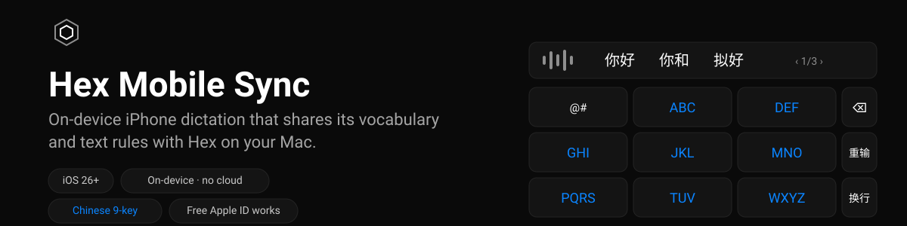

<p align="center">
  
</p>
<p align="center">
  <b>English</b> · <a href="README.zh-CN.md">简体中文</a>
</p>

> **Unofficial.** Hex Mobile Sync is a community companion to
> [Hex](https://github.com/anomalyco/hex). It is not affiliated with, endorsed
> by or supported by Hex, its author or Anomaly. Please report problems here,
> not to the Hex project.
>
> **This is a maintained fork** of the original
> [Hex Mobile Sync](https://github.com/backpropagation6/hex-mobile-sync) by
> Giovanni Liguori, adding a Chinese nine-key keyboard, a recent-dictation
> picker, key-tap feedback and curated contextual corrections. See
> [Credits](#credits).

**Status: usable, with rough edges.** It works for everyday dictation on the
authors' iPhones — keyboard, Action Button and Chinese nine-key included. The
known imperfections are in [Limitations](#limitations). Fixes and reports are
welcome.

Hex Mobile Sync is distributed as source only. You build it with Xcode and
install it on your own iPhone. There is no App Store build and no prebuilt
binary.

## What it is

An iPhone app plus a custom keyboard that dictate **entirely on device** with
Apple's `SpeechAnalyzer` (iOS 26+), clean the text up with Apple's on-device
language model, apply the same vocabulary and text rules you use in
[Hex](https://github.com/anomalyco/hex) on the Mac, and put the result wherever
you are typing. Audio and text never leave the iPhone; the app makes no
network requests.

```
Mac                                              iPhone
Hex.app ── hex CLI (--json) ──► mac/hex-mobile-sync.sh ──► iCloud Drive/Hex Mobile/
                                  ▲  (launchd: file watch + every 15 min)   hex-mobile-sync.json
                                  └── applies pending-vocabulary.json ◄──── pending-vocabulary.json
                                                                            iphone-history.jsonl (optional)

iPhone: Hex Mobile app ── SpeechAnalyzer (on device) ── accurate pass ── cleanup (on device) ── text pipeline ──► clipboard + history
          ▲   │
          │   └── Darwin notifications + pasteboard ──► Hex Mobile keyboard (any app)
          └── Action Button / Control Center / Shortcuts (App Intents, Live Activity)
```

- The Mac script reads Hex **only through the Hex CLI**. When Hex is not
  running it falls back to reading Hex's `settings.json` read-only. It never
  writes Hex's files. Hex's AI post-processing settings are never exported.
- The iPhone app reaches the `Hex Mobile` iCloud folder through a
  security-scoped bookmark picked once in Files — no iCloud entitlement.
- After the stop the text goes through: the accurate pass over the recording,
  the language-model cleanup, the spelling of your terms, then the Hex steps:
  vocabulary rewrite, mode replacements, transformations. Every step before
  the Hex ones falls back to the text it received.

Details: [docs/ARCHITECTURE.md](docs/ARCHITECTURE.md) · full spec:
[docs/PLAN.md](docs/PLAN.md).

## Features

**Dictation pipeline**

- **On-device transcription** with Apple's `SpeechAnalyzer` (iOS 26+). Audio
  never leaves the iPhone; no analytics, no cloud model.
- **Accurate second pass.** The live transcript uses the fast recognizer;
  at the stop the recording goes through the recognizer again without the
  fast option, and its text replaces the live one.
- **Optional Whisper pass** (off by default, `large-v3` turbo through
  WhisperKit): a model you copy to the iPhone yourself — the app never
  downloads it. See [Whisper (optional)](#whisper-optional).
- **Text cleanup.** "Fix the Text" (on by default) asks Apple's on-device
  language model to add punctuation and capitals, drop hesitations and apply
  spoken corrections, without rewording. When the model is unavailable, slow
  or unfaithful, you get the recognizer's text — a dictation never blocks.
- **Your own spelling.** Vocabulary terms also fix the case of the final text:
  `iphone` becomes `iPhone`. Only case, never letters.
- **Curated contextual corrections** *(this fork)*: a bundled JSON list of
  stubborn misrecognitions, each gated by the text that follows and a nearby
  context phrase, applied before the vocabulary — an ordinary word is never
  rewritten.

**The keyboard**

- **Chinese nine-key** *(this fork)*: a system-style 中文九键 layout on Rime
  (Luna Pinyin T9) — candidate bar with paging, quick punctuation column
  （，。？), 重输 / 换行, hold-to-repeat delete, a composite 中/英 key, and
  space or return committing the first candidate. The bundled Rime data is
  precompiled; the extension never runs deployment.
- **Recent dictations** *(this fork)*: the insert key inserts the latest
  dictation (repeats allowed), and holding it opens the last eight dictations
  to pick from.
- **Key feedback** *(this fork)*: a light haptic and the system keyboard click
  on every tap. (While a flow session is active, iOS mutes them — see
  [Limitations](#limitations).)
- Dictates into **any app**, Wispr Flow style: the app records and
  transcribes, the keyboard inserts. With no session running, one tap on the
  microphone opens the app, which starts a **flow session** and dictation at
  once.

**Everywhere**

- **Many ways to start:** the record button in the app (tap to toggle,
  long-press for push-to-talk), the Action Button, a Control Center control,
  Shortcuts and Siri, and the keyboard.
- **Live Activity** on the Lock Screen and in the Dynamic Island while
  recording, with a stop button.
- **Clipboard and history.** The final text is copied to the clipboard (can be
  turned off) and kept on device with a retention of a day, a week (default),
  a month or forever. History can optionally be shared with the Mac.

**Your Hex rules, private by design**

- **Shared vocabulary with Hex:** a launchd script on the Mac exports Hex's
  vocabulary, dictation language and modes to an iCloud Drive folder; the
  iPhone applies the same rewrites and passes up to 100 terms to the
  recognizer as context. **Two-way:** terms added on the iPhone are queued
  back to Hex.
- **Hex text rules:** mode replacements and the built-in transformations
  `lowercase`, `no-trailing-punctuation`, `spongebob-case`.
- **Works with a free Apple ID.** No App Groups, no iCloud entitlement, no
  push — nothing a free Personal Team cannot sign.
- English and Italian user interface.

- **Share extension signing:** Transfers adds a fourth App ID, `$(BUNDLE_ID_PREFIX).HexMobile.Share`. Free Personal Team App ID limits may prevent signing all four targets; use a paid developer account if needed. The share extension has no App Group or iCloud entitlement and asks for its own sync-folder bookmark.


## Screenshots

Captured on the iOS Simulator with synthetic demo content (Debug builds only —
see [docs/DEBUG-LAUNCH-OPTIONS.md](docs/DEBUG-LAUNCH-OPTIONS.md) for the launch
arguments). Live captures of the keyboard are still wanted.

| Dictate | History | Vocabulary | Settings |
|---|---|---|---|
|  |  |  |  |

## Requirements

- An iPhone with **iOS 26 or later** (the speech model downloads on first
  launch; the app shows a Download Model button).
- Optional, for "Fix the Text": an iPhone that supports Apple Intelligence,
  turned on, with the language model downloaded.
- A Mac with **Xcode 27.2 or later** to build, plus
  [XcodeGen](https://github.com/yonaskolb/XcodeGen) (`brew install xcodegen`).
- Network on the Mac for the first build only: Xcode fetches one Swift
  package, [WhisperKit](https://github.com/argmaxinc/argmax-oss-swift),
  pinned to 1.1.1. The app itself makes no network requests when it runs.
- An Apple ID — a free one is enough.
- For sync: Hex on the Mac, iCloud Drive on both devices (same Apple ID),
  and `jq` (shipped with recent macOS as `/usr/bin/jq`).
- Optional, for Whisper: about 630 MB free on the iPhone and the model on the
  Mac (see [docs/WHISPER.md](docs/WHISPER.md)).

## Install on your iPhone with a free Apple ID

1. **Get the source.**
   ```sh
   git clone <this repository> hex-mobile-sync
   cd hex-mobile-sync
   ```
2. **Add your Apple ID to Xcode.** Xcode > Settings > Accounts > `+` > Apple
   ID. Xcode creates a "Personal Team" for it.
3. **Set your team and a unique bundle ID prefix.**
   ```sh
   cp Config/Local.xcconfig.example Config/Local.xcconfig
   ```
   Edit `Config/Local.xcconfig` (gitignored):
   - `DEVELOPMENT_TEAM`: your team ID (Xcode > Settings > Accounts).
   - `BUNDLE_ID_PREFIX`: a reverse-DNS prefix of your own, e.g.
     `com.example.yourname`. Bundle identifiers must be unique per Apple ID,
     so the default `io.github.hexmobile` will usually not sign with a
     Personal Team.
4. **Generate the Xcode project** (the `.xcodeproj` is not committed):
   ```sh
   make project
   ```
5. **Turn on Developer Mode on the iPhone.** Connect by cable and trust the
   computer, then Settings > Privacy & Security > Developer Mode, and restart
   when asked.
6. **Build and install.** Either open `HexMobile.xcodeproj`, pick the
   `HexMobile` scheme and your iPhone, and press Run; or:
   ```sh
   xcrun devicectl list devices          # find your iPhone's identifier
   make install-device DEVICE=<identifier>
   ```
7. **Trust your developer certificate.** Settings > General > VPN & Device
   Management > your Apple ID > Trust.
8. **Open Hex Mobile**, allow microphone and speech recognition, and download
   the speech model for your language when the app asks.

### The 7-day limit

Apps signed by a free Personal Team expire **7 days** after signing. To renew,
connect the iPhone and run step 6 again — or let a small renewal ledger do it
for you (this repository's maintainers renew all their sideloaded apps with
one script; any equivalent `xcodebuild` + `devicectl` loop works).
Reinstalling over the same bundle identifier normally keeps app data; this
has not yet been confirmed on a device for this app.

Apple also limits how many app identifiers a free team can register per
period; this project registers three (app, widgets, keyboard).

### With a paid Apple Developer account

Everything works the same way; the provisioning profile just lasts up to a
year. No extra capability is used even with a paid account.

## Sync with Hex on your Mac

The Mac side is a shell script run by a per-user launchd agent (needs Hex with
its `hex` CLI, and `jq`):

1. Make sure iCloud Drive is on for the Mac.
2. Install the agent:
   ```sh
   mac/install.sh
   ```
   It runs at login, every 15 minutes, and on file changes, and creates
   `iCloud Drive/Hex Mobile` if missing. Check it once by hand:
   `mac/hex-mobile-sync.sh --dry-run --verbose`. Remove with `mac/uninstall.sh`
   (`--purge` also deletes the script, state and log; never the sync folder).
3. On the iPhone: Hex Mobile > Settings > Sync with Hex > Choose Sync
   Folder… > **iCloud Drive > Hex Mobile**, then Sync Now.

Flags, environment variables and error handling:
[mac/README.md](mac/README.md).

## The keyboard

1. iPhone Settings > General > Keyboard > Keyboards > Add New Keyboard… >
   **Hex Mobile**.
2. Tap it in the list and turn on **Allow Full Access**.
3. In any app, switch to it with the globe key and tap the microphone. With no
   flow session running, one tap opens Hex Mobile, which starts a **flow
   session** and dictation at once; go back to the app you were in (the
   back button at the top left, or swipe along the bottom edge) — the
   dictation keeps running either way.
4. While recording the keyboard shows ✕ and ✓; ✓ (or a tap on the microphone
   key) stops, transcribes and inserts at the cursor; ✕ drops the dictation.
   When a dictation fails, the top bar shows why, with Close and Retry.
5. The **insert key** (top left) inserts the latest dictation again whenever
   you tap it, and **holding it** opens the last eight dictations to pick
   from — handy for a dictation finished on the Action Button or elsewhere.
6. A session ends by itself after the idle time in Settings > Flow Session >
   End After Idle: 5 minutes (default), 15, 1 hour or Never. The Action
   Button's session is the exception: it ends after its dictation.

**The Chinese nine-key.** The globe key's neighbour or the 中/英 key switches
between the letters layer and 中文九键:

- A system-style layout: candidate bar (paging, `‹ n/m ›`) over the letter
  grid, a narrow punctuation column （，。？), and 重输 / 换行 on the right.
- Keys 2–9 feed Rime's Luna Pinyin T9 schema; space or return commits the
  first candidate; 重输 clears the composition; held ⌫ deletes faster and
  faster, composition first.
- Simplified Chinese output; the composed digits are deliberately not shown.

**Why Full Access?** A keyboard extension cannot record audio and, without an
App Group, cannot share storage with its app. So the app records and
transcribes and hands the result over; the keyboard needs Full Access to read
it. The keyboard has no network code and reads only the dictation the app
placed there. Because one channel is the pasteboard, a dictation started from
the keyboard is placed on the clipboard even when Copy to Clipboard is off;
that copy stays on the iPhone and expires after two minutes.

If no flow session is running and the microphone key cannot open the app (iOS
does not always let keyboards open apps), the keyboard says so: start the
session in Hex Mobile and come back.

## Action Button, Control Center and Shortcuts

The control **Hex Dictation** and the shortcut **Dictate with Hex Mobile** run
the same action: first press starts recording (a Live Activity appears),
second press stops, transcribes on the iPhone and returns the text. A session
opened from the Action Button ends after its dictation; iOS drops the
clipboard copy of a background dictation, so while the app waits for the
keyboard to take the text (at most one minute), the Live Activity shows its
start and asks you to open the Hex Mobile keyboard to insert it.

- **Action Button** (iPhone 15 Pro and later): Settings > Action Button >
  Controls > Hex Dictation.
- **Control Center:** `+` > Add a Control > Hex Dictation.
- **Shortcuts and Siri:** "Dictate with Hex Mobile" and "Start a Hex Mobile
  flow session".

The control is a button rather than a toggle: without an App Group the widget
cannot know whether the app is recording, so the Live Activity shows the
state instead. The same steps are in the app under Settings > Setup Guides.

## Whisper (optional)

The accurate pass can hand the recording to Whisper (`large-v3` turbo, 632 MB,
through [WhisperKit](https://github.com/argmaxinc/argmax-oss-swift), MIT)
after Apple's pass; when it finishes inside the time left, its text replaces
Apple's, prompted with your vocabulary terms. The default stays Apple.

**The app never downloads the model.** You copy it to the iPhone from the Mac
(`make push-whisper-model DEVICE=<udid>`), and Settings > Final Text Engine
offers Whisper only when the model is installed. The first load compiles the
model for the Neural Engine (about 12 minutes once on an iPhone 16 Pro; later
loads ~3 s), Whisper only runs when its estimate fits the 8 s budget after
the stop, and a text guard refuses a Whisper result that lost words against
Apple's.

Full detail — setup steps, the planning formulas, the gap guard, the piece
joining and every log line: [docs/WHISPER.md](docs/WHISPER.md).

## Diagnostics

When something fails, `diagnostics.log` (app) and `keyboard-diagnostics.log`
(keyboard extension container) say what happened — lifecycle events, audio
attempts with the system error, per-step timings. Neither holds dictated
text, all are excluded from backups, and nothing leaves the iPhone unless you
copy it:

```sh
xcrun devicectl device copy from --device <identifier> \
  --domain-type appDataContainer --domain-identifier <BUNDLE_ID_PREFIX>.HexMobile \
  --source "Library/Application Support/diagnostics.log" \
  --destination ./diagnostics.log
```

Read both before attaching them to an issue. Field-by-field detail:
[docs/DIAGNOSTICS.md](docs/DIAGNOSTICS.md).

## Privacy

- Transcription and text cleanup run entirely on the iPhone with Apple's
  on-device models. Audio never leaves the device. The app and its extensions
  make no network requests and include no analytics or crash reporting.
- While you dictate, the audio is written to a temporary file in Caches for
  the accurate pass and deleted when it is done. "Keep Audio to Improve
  Recognition" (off by default) keeps the last 20 dictations instead, in a
  folder excluded from backups, never synced, removable in Settings.
- The app links one third-party library, WhisperKit (MIT), for the optional
  Whisper engine. It contains code that downloads models from Hugging Face;
  the app never calls it (`download: false`) and refuses to start Whisper
  unless the model and tokenizer are already on disk.
- History is a JSON file pruned by the retention you choose and excluded from
  backups. "Share History with Mac" (off by default) writes final texts to
  the sync folder; raw recognizer output is not exported.
- The only data through iCloud Drive is what you put in the sync folder:
  exported vocabulary and modes, pending terms and, if enabled, the history
  export. Hex's AI post-processing prompt and model are never exported.
- The keyboard reads only the dictation payload the app hands it, and the
  recent-dictations list is served to it only inside the few-second window
  the keyboard's request opens.
- The app and the keyboard talk over Darwin notifications, which carry no
  data but are not authenticated: while a flow session is active, another app
  could start or stop a dictation. Without a session these signals are
  ignored.
- Each target ships a `PrivacyInfo.xcprivacy` privacy manifest.

## Limitations

- Source-only distribution; re-signing every 7 days with a free Apple ID.
- iPhone only; iOS 26 or later.
- Recognition quality depends on Apple's on-device model for your language.
- The text cleanup starts only if its estimate fits before 7.55 s after the
  stop; a dictation of more than about 1,500–1,700 characters comes back as
  the recognizer heard it, at once. The cleanup is discarded when it did
  anything but what it is asked to (hesitations, repeats and the phrase
  before an explicit correction are what it may remove).
- Per-app modes are not applied on the iPhone: the default mode, or one you
  pick by hand. Hex's custom transformations other than the three built-ins
  are skipped; LLM post-processing is not available.
- The keyboard cannot record by itself; it needs a flow session, and a flow
  session holds the microphone for its whole life. A consequence is cosmetic
  but noticeable: iOS mutes system sounds and haptics while an app records,
  so the keyboard's own key clicks and vibration are silent until the session
  ends (its taps still work and the feedback returns the moment the session
  ends).
- The Chinese nine-key output is simplified Chinese; the composed digits are
  not shown as pinyin (T9 digits are ambiguous).
- Whisper reads only what its time allows (~15 s of dictation with the
  vocabulary prompt), only the `large-v3` family, and the model must be
  copied by hand.

### Verified on a real device

Everyday dictation on iPhone 16 Pro: the keyboard into other apps, the Action
Button with the app in the background, Live Activities, the Chinese nine-key
end to end (candidates, paging, punctuation, recent dictations), and the
contextual corrections. The full list of what is and is not yet
device-verified: [docs/VERIFICATION.md](docs/VERIFICATION.md).

## Documentation

| File | Contents |
|---|---|
| [docs/ARCHITECTURE.md](docs/ARCHITECTURE.md) | how the pieces fit, the accurate pass, the text pipeline |
| [docs/PLAN.md](docs/PLAN.md) | the original full specification |
| [docs/TRANSFERS-PRD.md](docs/TRANSFERS-PRD.md) | product requirements for iPhone → Mac transfers (not built yet) |
| [docs/WHISPER.md](docs/WHISPER.md) | the optional Whisper engine in full detail |
| [docs/DIAGNOSTICS.md](docs/DIAGNOSTICS.md) | every field of the diagnostics logs |
| [docs/DEBUG-LAUNCH-OPTIONS.md](docs/DEBUG-LAUNCH-OPTIONS.md) | Debug-only launch arguments for simulator runs |
| [docs/VERIFICATION.md](docs/VERIFICATION.md) | what is verified on a device, what is not |
| [mac/README.md](mac/README.md) | the Mac sync script: flags, exit codes, logs |
| [tools/asr-bench](tools/asr-bench/README.md) · [tools/whisper-bench](tools/whisper-bench/README.md) | measure recognizers on device / reproduce Whisper on the Mac |

## Roadmap

- Keyboard and Live Activity screenshots from a real device, and a short demo
  video.
- **Mac relay engine.** All transcription already goes through a
  `TranscriptionEngine` protocol; a community Android client uses Hex on the
  Mac as a relay. The same idea fits here as a `MacRelayEngine`: audio
  streamed to Hex over the local network. It depends on Hex exposing a relay
  endpoint; today Hex's local API is only reachable by its owner on
  localhost.
- Per-app modes, if iOS gives keyboards enough context about the host app.
- More built-in transformations as Hex adds them.

## Contributing

Contributions are welcome: issues, device reports and pull requests. See
[CONTRIBUTING.md](CONTRIBUTING.md).

> **CI does not build the app yet.** GitHub's macOS runners ship Xcode 26, and
> this project needs Xcode 27. Until they update, CI runs only the Mac script
> tests: before opening a pull request run `make test-core` and
> `make build-device` locally and paste the result in the pull request.

Reports from real iPhones are the most useful thing right now: the keyboard,
the Action Button and background recording cannot be tested in CI.

## Credits

- **Giovanni Liguori** ([@backpropagation6](https://github.com/backpropagation6))
  wrote Hex Mobile Sync — the app, the sync pipeline, the keyboard and every
  idea in it. This fork continues his work; the features marked *this fork*
  above were added on top, and his README sections live on here (some moved
  into [docs](#documentation)).
- **The Chinese nine-key** stands on the RIME (中州韻) ecosystem:
  - [RIME](https://github.com/rime/home) — the 朙月拼音 (Luna Pinyin) schema
    and dictionary by the RIME Developers (佛振 and contributors), plus the
    essay, prelude and stroke resources (LGPL-3.0), and
    [librime](https://github.com/rime/librime) (BSD-3). The source files are
    re-pinned to the official RIME repositories in
    `Keyboard/Resources/RimeData/source-manifest.json`.
  - [LibrimeKit](https://github.com/zhanggenlove/LibrimeKit) (BSD-3) — the
    Swift bindings and the prebuilt librime for iOS.
  - [Universe Keyboard](https://github.com/shchnk1103/Universe-Keyboard) —
    whose RimeBuiltin package supplied the precompiled resources bundled
    here (see `Keyboard/Resources/RimeData/README-HEX.md`).
  - [OpenCC](https://github.com/BYVoid/OpenCC) (Apache-2.0) — the
    simplified-Chinese conversion.
  - The dictionary carries its own upstream acknowledgements — CC-CEDICT,
    Android PinyinIME, Chewing (新酷音), 萌典 and others — preserved in
    `Keyboard/Resources/RimeData/licenses/`.

## License

[MIT](LICENSE). "Hex" is the name of a separate project by its own author;
this repository only interoperates with it through its public CLI.
