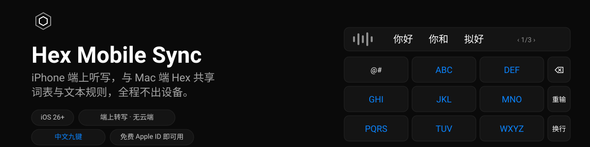

<p align="center">
  
</p>
<p align="center">
  <a href="README.md">English</a> · <b>简体中文</b>
</p>

> **非官方项目。** Hex Mobile Sync 是 [Hex](https://github.com/anomalyco/hex)
> 的社区伴生项目，与 Hex 本体、其作者及 Anomaly 均无隶属或背书关系。问题请
> 反馈到本仓库，不要去打扰 Hex 项目。
>
> **本项目是维护中的 fork**，基于 Giovanni Liguori 的
> [Hex Mobile Sync](https://github.com/backpropagation6/hex-mobile-sync)，
> 新增了中文九键键盘、最近听写选择、按键反馈与定向纠错。见
> [致谢](#致谢)。

**状态：可用，仍有毛边。** 在作者的 iPhone 上支撑日常听写——键盘、Action
Button、中文九键都包括。已知缺陷见[局限性](#局限性)。欢迎反馈与修复。

本项目只分发源码：用 Xcode 自行构建、安装到自己的 iPhone。没有 App Store
版本，也没有预编译包。

## 这是什么

一个 iPhone App 加一个自定义键盘：用 Apple 的 `SpeechAnalyzer`（iOS 26+）
**全程端上**听写，用 Apple 端上语言模型清理文本，套用你在 Mac 端
[Hex](https://github.com/anomalyco/hex) 里的同一套词表与文本规则，把结果放进
你正在打字的地方。音频和文本都不离开 iPhone；App 运行时不发任何网络请求。

```
Mac                                              iPhone
Hex.app ── hex CLI (--json) ──► mac/hex-mobile-sync.sh ──► iCloud Drive/Hex Mobile/
                                  ▲  (launchd: 文件监视 + 每 15 分钟)        hex-mobile-sync.json
                                  └── 应用 pending-vocabulary.json ◄─────── pending-vocabulary.json
                                                                            iphone-history.jsonl（可选）

iPhone：Hex Mobile App ── SpeechAnalyzer（端上）── 精确二次转写 ── 文本清理（端上）── 文本流水线 ──► 剪贴板 + 历史
          ▲   │
          │   └── Darwin 通知 + 剪贴板 ──► Hex Mobile 键盘（任意 App）
          └── Action Button / 控制中心 / 快捷指令（App Intents、实况活动）
```

- Mac 脚本**只通过 Hex CLI** 读取 Hex；Hex 未运行时退化为只读它的
  `settings.json`。从不写 Hex 的文件。Hex 的 AI 后处理设置绝不导出。
- iPhone App 通过在「文件」里选择一次的安全作用域书签访问 iCloud 的
  `Hex Mobile` 文件夹——不需要 iCloud 权限声明。
- 停止之后文本依次经过：对录音的精确二次转写、语言模型清理、个人词条拼写，
  然后是 Hex 的步骤：词表改写、模式替换、转换。Hex 之前的每一步失败都会
  回退为收到的文本。

细节见 [docs/ARCHITECTURE.md](docs/ARCHITECTURE.md)；完整规格见
[docs/PLAN.md](docs/PLAN.md)。

## 功能

**听写流水线**

- **端上转写**：Apple `SpeechAnalyzer`（iOS 26+），音频不出 iPhone；无统计
  埋点、无云端模型。
- **精确二次转写**：实时文本用快速识别器；停止后整段录音再过一遍不带快速
  选项的识别器，其文本替换实时文本。
- **可选 Whisper 二次转写**（默认关闭，`large-v3` turbo，经 WhisperKit）：
  模型由你自己拷进 iPhone——App 绝不下载。见
  [Whisper（可选）](#whisper可选)。
- **文本清理**：「Fix the Text」（默认开启）请 Apple 端上语言模型加标点、
  大写，去掉犹豫词、执行口述更正，但不改写内容。模型不可用、太慢或不忠实
  时，你拿到的是识别器原文——听写永远不会被卡住。
- **你自己的拼写**：词表词条还会修正最终文本的大小写：`iphone` 变
  `iPhone`。只动大小写，不动字母。
- **定向纠错**（*本 fork*）：内置一份 JSON 清单，记录顽固误识别，每条都以
  后文和邻近上下文短语为门限，在词表之前应用——普通词永远不会被误改。

**键盘**

- **中文九键**（*本 fork*）：Rime（Luna Pinyin T9）驱动的系统风格九键——
  候选条带翻页、快捷标点列（，。？）、重输 / 换行、长按连删、中/英复合键，
  空格或回车上屏首选。Rime 数据随包预编译，扩展内不做部署。
- **最近听写**（*本 fork*）：插入键点按即插最近一条（可重复插入），长按弹出
  最近 8 条任选。
- **按键反馈**（*本 fork*）：每次按键有轻触感 + 系统键盘咔哒声。（flow
  session 活跃期间 iOS 会将其静音，见[局限性](#局限性)。）
- **打进任意 App**（Wispr Flow 式）：App 负责录音转写，键盘负责插入。没有
  会话时，点一下麦克风键即打开 App 并立刻开始 **flow session** 和听写。

**随处可用**

- **多种启动方式**：App 内大录音键（点按开关、长按按住说话）、Action
  Button、控制中心控件、快捷指令与 Siri，以及自定义键盘。
- **实况活动**：录音时出现在锁屏与灵动岛，带停止按钮。
- **剪贴板与历史**：最终文本复制到剪贴板（可关），并保留在本机历史中，保留
  期一天 / 一周（默认）/ 一月 / 永久。历史可选同步到 Mac。

**你的 Hex 规则，隐私优先**

- **与 Hex 共享词表**：Mac 上一个 launchd 脚本把 Hex 的词表、听写语言和模式
  导出到 iCloud 文件夹；iPhone 应用同样的改写，并把至多 100 个词条作为上下文
  传给识别器。**双向**：iPhone 上加的词条会排队回 Hex。
- **Hex 文本规则**：模式替换与内置转换 `lowercase`、
  `no-trailing-punctuation`、`spongebob-case`。
- **免费 Apple ID 可用**。不用 App Groups、iCloud 权限、推送——个人
  Team 签不了的一概不用。
- 界面语言：英语与意大利语。

## 截图

截图取自 iOS 模拟器的合成演示内容（仅 Debug 构建——启动参数见
[docs/DEBUG-LAUNCH-OPTIONS.md](docs/DEBUG-LAUNCH-OPTIONS.md)）。键盘的真机
截图仍欠着。

| 听写 | 历史 | 词表 | 设置 |
|---|---|---|---|
|  |  |  |  |

## 环境要求

- **iOS 26 或更高**的 iPhone（语音模型首次启动时由 iOS 下载，App 会给出
  Download Model 按钮）。
- 可选，用「Fix the Text」：支持 Apple Intelligence 且已开启、语言模型已
  下载的 iPhone。
- 一台 Mac，**Xcode 27.2 或更高**用于构建，外加
  [XcodeGen](https://github.com/yonaskolb/XcodeGen)（`brew install
  xcodegen`）。
- 仅首次构建需要网络：Xcode 拉取一个 Swift 包
  （[WhisperKit](https://github.com/argmaxinc/argmax-oss-swift)，固定
  1.1.1）。App 运行时不发任何网络请求。
- 一个 Apple ID——免费账号即可。
- 同步：Mac 上装有 Hex，两端开启 iCloud Drive（同一 Apple ID），以及
  `jq`（新版 macOS 自带 `/usr/bin/jq`）。
- 可选，Whisper：iPhone 上约 630 MB 空间，模型放在 Mac 上（见
  [docs/WHISPER.md](docs/WHISPER.md)）。

## 用免费 Apple ID 装到 iPhone

1. **取源码。**
   ```sh
   git clone <本仓库> hex-mobile-sync
   cd hex-mobile-sync
   ```
2. **把 Apple ID 加进 Xcode**：Xcode > Settings > Accounts > `+` > Apple
   ID。Xcode 会为其创建「Personal Team」。
3. **设置 Team 与专属 bundle ID 前缀。**
   ```sh
   cp Config/Local.xcconfig.example Config/Local.xcconfig
   ```
   编辑 `Config/Local.xcconfig`（已 gitignore）：
   - `DEVELOPMENT_TEAM`：你的 Team ID（Xcode > Settings > Accounts）。
   - `BUNDLE_ID_PREFIX`：你自己的反域前缀，如 `com.example.yourname`。
     bundle identifier 按 Apple ID 唯一，默认的 `io.github.hexmobile` 通常
     无法用个人 Team 签名。
4. **生成 Xcode 工程**（`.xcodeproj` 不入库）：
   ```sh
   make project
   ```
5. **iPhone 打开开发者模式**：数据线连接并信任电脑，然后设置 > 隐私与
   安全性 > 开发者模式，按提示重启。
6. **构建并安装**。可以打开 `HexMobile.xcodeproj`，选 `HexMobile` scheme 和
   你的 iPhone 后 Run；或：
   ```sh
   xcrun devicectl list devices          # 找到你 iPhone 的标识符
   make install-device DEVICE=<标识符>
   ```
7. **信任开发者证书**：设置 > 通用 > VPN 与设备管理 > 你的 Apple ID >
   信任。
8. **打开 Hex Mobile**，允许麦克风与语音识别，并按提示下载你语言的语音
   模型。

### 7 天有效期

免费 Personal Team 签名的 App **7 天后过期**。续期 = 连上 iPhone 重跑第 6
步——或者用一个小小的续签台账一键搞定（本仓库维护者用一个脚本续签所有
自签 App；任何等价的 `xcodebuild` + `devicectl` 循环都行）。同一 bundle
identifier 覆盖安装一般会保留 App 数据（历史、设置、同步文件夹选择）；这一
点在本 App 上还未确证。

Apple 还限制免费 Team 周期内能注册的 App 标识符数量；本项目注册三个
（App、小组件、键盘）。

### 付费 Apple Developer 账号

一切相同，只是描述文件最长一年有效，极少重签。付费账号也不需要任何额外资
质。

## 与 Mac 端 Hex 同步

Mac 侧是一个由 per-user launchd 代理运行的脚本（需要装有含 `hex` CLI 的
Hex，以及 `jq`）：

1. 确认 Mac 已开启 iCloud Drive。
2. 安装代理：
   ```sh
   mac/install.sh
   ```
   它在登录时、每 15 分钟、以及文件变化时运行，若缺失会创建
   `iCloud Drive/Hex Mobile`。手动跑一次验证：
   `mac/hex-mobile-sync.sh --dry-run --verbose`。卸载用 `mac/uninstall.sh`
   （`--purge` 连脚本、状态和日志一起删；同步文件夹绝不删除）。
3. iPhone 上：Hex Mobile > Settings > Sync with Hex > Choose Sync Folder… >
   **iCloud Drive > Hex Mobile**，然后 Sync Now。

参数、环境变量与错误处理见 [mac/README.md](mac/README.md)。

## 键盘

1. iPhone 设置 > 通用 > 键盘 > 键盘 > 添加新键盘…… > **Hex Mobile**。
2. 在列表中点它，打开**允许完全访问**。
3. 在任意 App 里用地球键切到 Hex Mobile 键盘，点麦克风。没有 flow session
   时，一下点按会打开 Hex Mobile，它立刻开始 **flow session** 和听写；回到
   原来的 App（左上角的返回按钮，或沿底边右滑）——无论回没回去听写都继续。
4. 录音时键盘显示 ✕ 和 ✓；✓（或点麦克风键）停止、转写并插入光标处；✕ 丢弃
   该条。听写失败时顶栏显示原因，带关闭与重试。
5. **插入键**（左上）：点按即再插最近一条听写；**长按**弹出最近 8 条任选——
   Action Button 或别处完成的听写都能在这里取回。
6. 会话在 Settings > Flow Session > End After Idle 设定的空闲时间后自动
   结束：5 分钟（默认）、15 分钟、1 小时或永不。Action Button 的会话例外：
   它的会话在该条听写后结束。

**中文九键。** 通过中/英键在字母层与中文九键间切换：

- 系统风格布局：候选条（翻页 `‹ n/m ›`）压着字母网格，左侧窄标点列
  （，。？），右侧重输 / 换行。
- 2–9 键送入 Rime 的 Luna Pinyin T9 方案；空格或回车上屏首选；重输清空
  组词；⌫ 长按越删越快，先删组词再删正文。
- 输出简体中文；组词数字串刻意不显示。

**为什么需要完全访问？** 键盘扩展不能录音，而且没有 App Group 就无法与主
App 共享存储。所以录音和转写由 App 完成、结果递交，键盘需要完全访问才能
读到。键盘没有网络代码，只读 App 放入的那条听写。因为通道之一是剪贴板，
从键盘发起的听写即使关掉「复制到剪贴板」也会上剪贴板；这份拷贝留在 iPhone
上，两分钟后过期。

没有 flow session 且麦克风键打不开 App 时（iOS 不总允许键盘打开 App），键盘
会说明：去 Hex Mobile 开会话再回来。

## Action Button、控制中心与快捷指令

控件 **Hex Dictation** 与快捷指令 **Dictate with Hex Mobile** 是同一个动
作：第一次按开始录音（出现实况活动），第二次按停止、端上转写并返回文本。
Action Button 开的会话在该条听写后结束；iOS 会丢弃后台完成听写的剪贴板拷
贝，所以 App 等键盘取文本的至多一分钟里，实况活动会显示文本开头并请你打开
Hex Mobile 键盘插入。

- **Action Button**（iPhone 15 Pro 及之后）：设置 > Action Button > 控件 >
  Hex Dictation。
- **控制中心**：`+` > 添加控件 > Hex Dictation。
- **快捷指令与 Siri**：「Dictate with Hex Mobile」「Start a Hex Mobile flow
  session」。

控件是按钮而不是开关：没有 App Group，小组件无法知道 App 是否在录音，状态
由实况活动展示。同样的步骤在 App 的 Settings > Setup Guides 里。

## Whisper（可选）

精确二次转写可以在 Apple 之后把录音交给 Whisper（`large-v3` turbo，
632 MB，经 [WhisperKit](https://github.com/argmaxinc/argmax-oss-swift)，
MIT）；在剩余时间内跑完时，其文本以你的词表为提示替换 Apple 的文本。默认
仍是 Apple。

**App 绝不下载模型。** 模型由你从 Mac 拷到 iPhone
（`make push-whisper-model DEVICE=<udid>`），装好模型后 Settings > Final
Text Engine 才会提供 Whisper。首次加载要为神经网络引擎编译模型（iPhone
16 Pro 上一次约 12 分钟；之后约 3 秒），Whisper 只在估算能塞进停止后 8 秒
预算时才跑，且有文本守卫拒绝丢词的 Whisper 结果。

完整细节——安装步骤、规划公式、间隙守卫、分段拼接与全部日志行：见
[docs/WHISPER.md](docs/WHISPER.md)。

## 诊断

出问题时，`diagnostics.log`（App）与 `keyboard-diagnostics.log`（键盘扩展
容器）说明发生了什么——生命周期事件、带系统错误的音频尝试、分步耗时。都
不含听写文本，都不进备份，不主动离开 iPhone：

```sh
xcrun devicectl device copy from --device <标识符> \
  --domain-type appDataContainer --domain-identifier <BUNDLE_ID_PREFIX>.HexMobile \
  --source "Library/Application Support/diagnostics.log" \
  --destination ./diagnostics.log
```

提 issue 前先读一遍。逐字段说明：[docs/DIAGNOSTICS.md](docs/DIAGNOSTICS.md)。

## 隐私

- 转写与文本清理全程在 iPhone 上用 Apple 端上模型完成。音频不出设备。
  App 与扩展不发网络请求，无统计、无崩溃上报。
- 听写时音频会写入 Caches 的临时文件供精确转写用，完成后删除。「Keep
  Audio to Improve Recognition」（默认关）改为保留最近 20 条，放在排除备份
  的文件夹里，从不同步，可在设置中删除。
- App 只链接一个第三方库：WhisperKit（MIT），用于可选的 Whisper 引擎。它
  含有从 Hugging Face 下载模型的代码；App 绝不调用（`download: false`），
  模型与 tokenizer 不在磁盘上就拒绝启动。
- 历史是一个按你选的保留期修剪的 JSON 文件，排除备份。「Share History
  with Mac」（默认关）把最终文本写入同步文件夹；识别器原始输出不导出。
- 经过 iCloud Drive 的只有你放进同步文件夹的内容：导出的词表与模式、待应用
  词条，以及（如开启）历史导出。Hex 的 AI 后处理提示词与模型绝不导出。
- 键盘只读 App 递交的听写载荷；最近听写列表也只在键盘请求打开的几秒窗口内
  可被取走。
- App 与键盘通过 Darwin 通知通信：不带数据，但未鉴权——flow session 活跃
  时，其他 App 也可能开始或停止一次听写。没有会话时这些信号被忽略。
- 每个 target 都带 `PrivacyInfo.xcprivacy` 隐私清单。

## 局限性

- 只分发源码；免费 Apple ID 每 7 天重签。
- 仅 iPhone；iOS 26 或更高。
- 识别质量取决于 Apple 你所用语言的端上模型。
- 文本清理只在估算能在停止后 7.55 秒内完成时启动；超过约 1,500–1,700 字符
  的听写立刻以识别原文返回。清理做了任何超出分内的事都会被丢弃（它只允许
  删犹豫词、重复和口述更正前的短语）。
- 分 App 模式在 iPhone 上不生效：用默认模式或手选的一个模式。除三个内置转
  换外的 Hex 自定义转换被跳过；LLM 后处理不可用。
- 键盘不能自己录音；它需要 flow session，而 flow session 在整个生命周期内
  持有麦克风。一个观感上的后果：iOS 在有 App 录音时会静音系统音与触感，
  键盘自己的键击声与振动在会话结束前都是哑的（按键照常工作，会话一结束反馈
  立刻回来）。
- 中文九键输出简体中文；组词数字串不以拼音显示（T9 数字有歧义）。
- Whisper 只读它时间允许的长度（带词表提示约 15 秒的听写），只收
  `large-v3` 系列，模型须手动拷入。

### 真机验证情况

iPhone 16 Pro 上的日常听写：键盘打进其他 App、后台 Action Button、实况
活动、中文九键全流程（候选、翻页、标点、最近听写）与定向纠错。完整的
已验证/未验证清单：[docs/VERIFICATION.md](docs/VERIFICATION.md)。

## 文档

| 文件 | 内容 |
|---|---|
| [docs/ARCHITECTURE.md](docs/ARCHITECTURE.md) | 各部分如何协作、精确转写、文本流水线 |
| [docs/PLAN.md](docs/PLAN.md) | 原始完整规格 |
| [docs/WHISPER.md](docs/WHISPER.md) | 可选 Whisper 引擎的全部细节 |
| [docs/DIAGNOSTICS.md](docs/DIAGNOSTICS.md) | 诊断日志逐字段说明 |
| [docs/DEBUG-LAUNCH-OPTIONS.md](docs/DEBUG-LAUNCH-OPTIONS.md) | Debug 构建的启动参数 |
| [docs/VERIFICATION.md](docs/VERIFICATION.md) | 真机已验证 / 未验证清单 |
| [mac/README.md](mac/README.md) | Mac 同步脚本：参数、退出码、日志 |
| [tools/asr-bench](tools/asr-bench/README.md) · [tools/whisper-bench](tools/whisper-bench/README.md) | 真机测识别器 / Mac 复现 Whisper |

## 路线图

- 键盘与实况活动的真机截图，以及一段演示视频。
- **Mac 中继引擎。** 转写已全部走 `TranscriptionEngine` 协议；社区已有
  Android 客户端把 Mac 端 Hex 当中继。同样的思路适合这里（`MacRelayEngine`）：
  音频经局域网流到 Hex，iPhone 用上桌面同款模型与规则。前提是 Hex 暴露中继
  端点；目前 Hex 的本地 API 仅限本机所有者访问。
- 分 App 模式——若 iOS 能给键盘足够的宿主 App 上下文。
- Hex 新增内置转换时跟进。

## 参与

欢迎贡献：issue、真机报告和 pull request。见
[CONTRIBUTING.md](CONTRIBUTING.md)。

> **CI 尚不能构建 App。** GitHub 的 macOS runner 是 Xcode 26，本项目需要
> Xcode 27。在他们更新之前，CI 只跑 Mac 脚本测试：开 PR 前请在本地跑
> `make test-core` 和 `make build-device`，并把结果贴进 PR。

真机报告是目前最有价值的贡献：键盘、Action Button 和后台录音在 CI 里测
不了。

## 致谢

- **Giovanni Liguori**
  （[@backpropagation6](https://github.com/backpropagation6)）写出了 Hex
  Mobile Sync——这个 App、同步流水线、键盘以及其中的每一个想法。本 fork 延续
  他的工作；上文标注 *本 fork* 的功能是后来添加的，他的 README 章节也都还在
  （部分移入了[文档](#文档)）。
- **中文九键**站在 RIME（中州韻）生态之上：
  - [RIME](https://github.com/rime/home)——RIME Developers（佛振及贡献者）的
    朙月拼音方案与词表，以及八股文、prelude、笔画资源（LGPL-3.0），和
    [librime](https://github.com/rime/librime) 引擎（BSD-3）。源文件在
    `Keyboard/Resources/RimeData/source-manifest.json` 中逐一对准官方仓库。
  - [LibrimeKit](https://github.com/zhanggenlove/LibrimeKit)（BSD-3）——Swift
    绑定与预编译的 iOS librime。
  - [Universe Keyboard](https://github.com/shchnk1103/Universe-Keyboard)——
    本文捆绑的预编译资源来自其 RimeBuiltin 资源包（见
    `Keyboard/Resources/RimeData/README-HEX.md`）。
  - [OpenCC](https://github.com/BYVoid/OpenCC)（Apache-2.0）——简体中文转换。
  - 词表自身还带着上游致谢——CC-CEDICT、Android PinyinIME、新酷音、萌典等
    ——完整保留在 `Keyboard/Resources/RimeData/licenses/`。

## 许可证

[MIT](LICENSE)。「Hex」是另一独立项目的名称，归其作者所有；本仓库仅通过其
公开 CLI 与之互操作。
